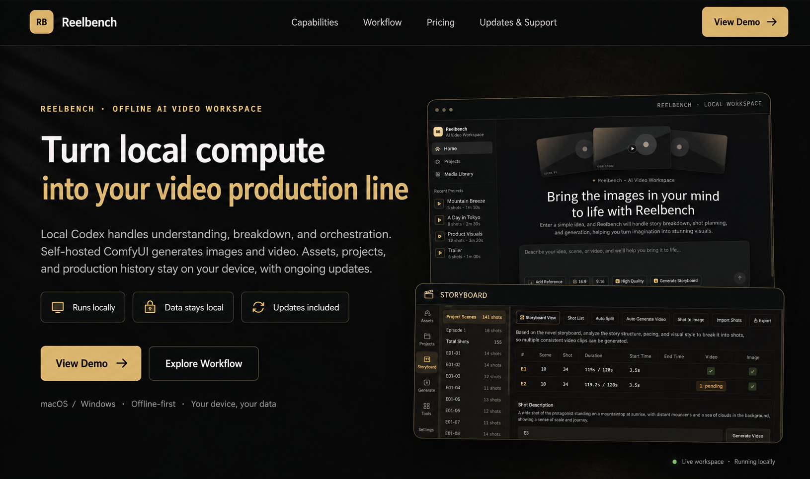

<div align="center">

# reelbench-skills

**Claude Code / Codex skills for working with video.**

English | [中文](README.zh.md) | [Telegram @ahao_dev](https://t.me/ahao_dev) | [X @eternityspring](https://x.com/eternityspring)

**[Skills](#skills) · [Install](#install) · [Example](#example) · [What it looks like](#what-it-looks-like)**

</div>

## ❤️ Sponsor

> [Want to appear here?](mailto:eternityspring@gmail.com)

<details open>
<summary>Click to collapse</summary>

<table>
<tr>
<td width="180"><a href="https://studio.reelbenchai.com"></a></td>
<td><a href="https://studio.reelbenchai.com">Reelbench Studio</a> is a paid AI video workspace built by the author of these skills, delivered as source code that runs offline. Local Codex handles understanding, breakdown and orchestration, a self-hosted ComfyUI generates the images and video, and your assets and projects stay on your own machine.</td>
</tr>
<tr>
<td width="180"></td>
<td>赛博班底 is a WeChat mini program built by the author of these skills: reference images for AI short video, covering characters, costumes, expressions and more, filterable by category and tag. Every image comes with a Chinese prompt you can copy in one tap, and you can long-press the full-size image to save it. Scan the code on the left in WeChat to open it.</td>
</tr>
</table>

</details>

## Skills

| skill | what it does |
| --- | --- |
| [video-shots](skills/video-shots/README.en.md) | **Shot breakdown**: turns a finished film into a shot-by-shot table — duration, shot size, category, camera move, frame description, rhythm role. Cuts and durations are measured by ffmpeg; the model only judges what it should; 15 quality gates check every call. |
| [video-sync](skills/video-sync/README.en.md) | **Composites a video with the shot data alongside it**: footage on one side, the current shot's data on the other, switching at every cut with the list scrolling and highlighting itself. Landscape stacks, portrait sits side by side; the layout is one CSS file. |
| [video-scrub](skills/video-scrub/README.en.md) | **Strips metadata**: rebuilds the film as a clean file carrying only picture and sound — GPS, device, account IDs and telemetry tracks all left behind. The hard part is the three layers `ffprobe` cannot see: SEI, the AAC DSE, and compressorname. Byte-for-byte picture by default, verified by 12 byte-level gates. |

## AI video community

I run a paid group about AI video — workflows, tools, and how this stuff actually gets done.

Interested? Message me on Telegram **[@ahao_dev](https://t.me/ahao_dev)** and mention **`github`**.

## Install

```bash
git clone https://github.com/eternityspring/reelbench-skills.git
cd reelbench-skills
./scripts/install.sh
```

This symlinks the skills into `~/.claude/skills/` and/or `~/.codex/skills/` (whichever exists),
so **`git pull` takes effect immediately**.

```bash
./scripts/install.sh --claude      # Claude Code only
./scripts/install.sh --codex       # codex only
./scripts/install.sh video-shots   # one skill only
./scripts/install.sh --uninstall   # remove the symlinks
```

Requirements: `node` >= 18 and `ffmpeg` / `ffprobe` (macOS: `brew install node ffmpeg`).
**No npm dependencies, no API keys** — it runs on your current session.

Prefer a copy over a symlink? `cp -r skills/video-shots ~/.claude/skills/` —
each skill is self-contained.

## Example

`demo-report/` is the **real output** of running the skill on `demo-video.mp4`
(a 202.9-second AI-generated short film, *啥是AI*): 53 shots, 3.83 s average shot length,
15.7 cuts per minute, all 15 gates green. `demo-report-en/` is the same pipeline run on a
287.4-second English excerpt with `--lang en` — an entirely English report: 46 shots, 6.25 s
average, and one 46.92 s take that scene detection never cut, because it genuinely never cuts.

[](demo-report/shots-report.html)

The report is a **single interactive page**: an embedded player (playback highlights the current
shot, click a shot to jump), a pace strip, a shot list you can search, filter and sort (list or
card view, first and last keyframe side by side, click a frame to enlarge), distributions, cast,
and the quality gates. No external dependencies — double-click it offline.


```
demo-report/
├── shots-report.html   ← clone and double-click
├── shots.json          ← the breakdown data for all 53 shots
├── shots.md            ← Markdown shot list
├── track.json          ← frame-difference motion curve (the machine's evidence)
└── frames/             ← first and last keyframe of every shot, 106 files
```

`demo-scrub/` is what **video-scrub** produces — four pieces of text and no video, because its
output looks **exactly like the source**, which is the whole point. What is worth reading is the
reconciliation, above all [`half.txt`](demo-scrub/half.txt): the textbook recipe leaves `ffprobe`
looking spotless while the bitstream still carries x264's encoder-settings SEI in 4 places and the
AAC DSE in 8 — **no `ffprobe` command shows either of them**.

What **video-sync** produces is at the bottom of this page — as a video, not a screenshot.

## What it looks like

A 287.4-second English excerpt with its 46-shot breakdown, 1280×1296 (the source is 640×360,
blown up with `--scale 2`). The panel switches with every cut; the list scrolls up and the
highlight rides along:

<video src="https://github.com/eternityspring/reelbench-skills/raw/main/demo-sync/demo-en-sync.mp4" controls muted playsinline width="760"></video>

If the player does not load, grab the file: [`demo-sync/demo-en-sync.mp4`](demo-sync/demo-en-sync.mp4)
